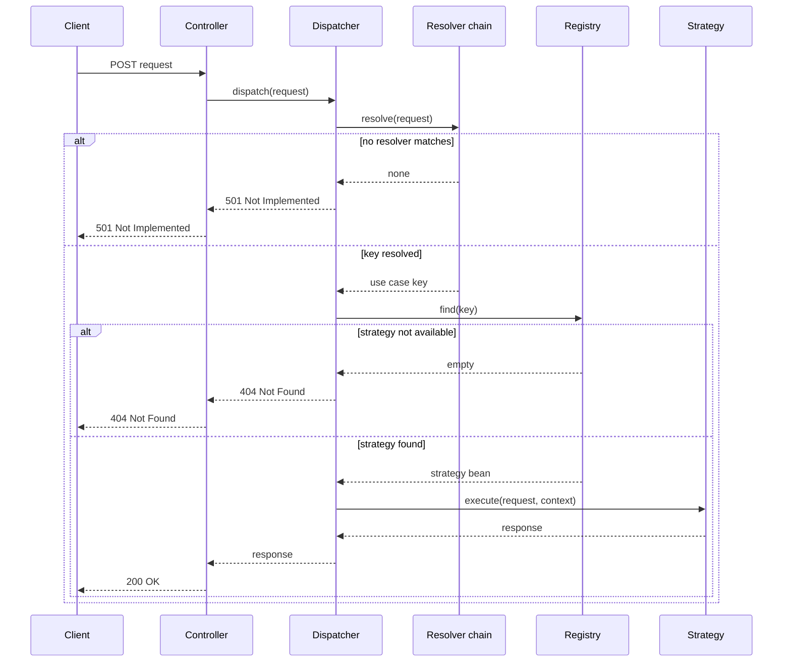

# Technical specification: Switchboard — Spring Boot 4.x starter library

**Stack:** Java 17+ (Spring Boot 4 recommends the latest LTS while still supporting 17), Spring Boot 4.x only, Spring Framework 7, Jakarta EE 11 / Servlet 6.1
**Status:** v2.0 — consolidated to a single Spring Boot 4-only library, restructured as a proper two-module starter
**Author:** [fill in]

---

## 0. Library packaging: back to one library, now properly structured as a starter

Switchboard's history: originally scoped inside one app, then extracted as a shared-core starter across Boot 2.x/3.x, then split into two fully independent libraries (`switchboard-spring-boot2`, `switchboard-spring-boot3`) once the shared-core approach proved awkward for the javax/jakarta split. **That split is now retired.** Spring Boot 4.x is the new minimum version — Boot 2.x and 3.x support is dropped outright, not maintained as a legacy line. Since Boot 4 has exactly one servlet namespace (`jakarta.servlet`, Servlet 6.1), the entire reason for the two-library split disappears, and Switchboard collapses back into a single library.

**What this means in practice:**
- **One codebase, one version line.** No more parity checklist between two libraries — there's only one implementation to change.
- **Every resolver is now plain, single-version code.** The `PayloadFieldResolver` Java 8-vs-17 split from the two-library era no longer applies — with Boot 2 gone, there's only one Java baseline (17+), so the `instanceof` pattern-matching form is simply *the* implementation, not one of two.
- **Publishing target:** internal Nexus/Artifactory, as **two modules of one release** (not two independently-versioned products, unlike the old two-library setup) — a thin starter and an autoconfigure module, matching the convention established for Pipeline Framework and Directory (section 12).
- **Framework vs. business logic still applies.** Switchboard provides the *framework* (registry, resolver chain, dispatcher, config binding, actuator endpoint); each consuming app provides its own *strategies* and controller. `@ConditionalOnMissingBean` is used throughout so any bean can be overridden.
- **Migration note:** teams still on Spring Boot 2.x or 3.x have no upgrade path via Switchboard until they move to Boot 4 — this is a deliberate scope decision, not an oversight. If that's a real near-term blocker for any consuming team, flag it now rather than after this spec moves to implementation.

### 0.1 Module structure

Matching Pipeline Framework's pattern: a thin starter (dependencies only) plus an autoconfigure module (all the actual code):

```
switchboard-autoconfigure            (all the code from sections 3–10 below)
├── SwitchboardStrategy<Req, Res>
├── SwitchboardResolver / SwitchboardResolverChain   (jakarta.servlet.http.HttpServletRequest directly — no other version to accommodate)
├── SwitchboardRegistry
├── SwitchboardDispatcher
├── SwitchboardAutoConfiguration
├── SwitchboardProperties (config binding)
├── exceptions (SwitchboardUnresolvedException, SwitchboardNotAvailableException)
├── SwitchboardEndpoint
└── META-INF/spring/org.springframework.boot.autoconfigure.AutoConfiguration.imports

switchboard-spring-boot-starter      (no code — pom.xml only)
├── depends on: switchboard-autoconfigure
└── depends on: spring-boot-starter-webmvc   (Boot 4's renamed MVC starter)
```

Consuming apps declare only the starter:

```xml
<dependency>
  <groupId>com.yourorg</groupId>
  <artifactId>switchboard-spring-boot-starter</artifactId>
  <version>2.0.0</version>
</dependency>
```


## 1. Problem statement

Multiple use cases share the same API contract (request/response schema), but each needs different business logic executed. We want:

- A single controller/endpoint (or small set of endpoints) that doesn't grow an `if/else` or `switch` per use case.
- A way to determine, from the incoming request, *which* use case applies — using a **combination of signals** (header, payload field, route) rather than just one.
- Maximum **configurability**: adding, disabling, or reordering use cases should require minimal-to-no code changes in the dispatch path.
- **As a library**: the framework itself (registry, resolver chain, dispatcher) ships as a single Spring Boot 4.x starter; each consuming app depends on it and supplies its own strategies and controller.

## 2. Design patterns used

| Pattern | Where it's used | Why |
|---|---|---|
| **Strategy** | Core business logic per use case | Same interface, swappable implementation — the textbook fit for "same contract, different behavior" |
| **Chain of Responsibility** | Use-case *resolution* (deciding which strategy to run) | You want header → payload → route checked in order, each resolver deciding "I can answer" or "pass to the next" |
| **Registry (Factory-like)** | Strategy lookup by key | Spring's `ApplicationContext` auto-collects all strategy beans at startup; no manual factory `switch` needed |
| **Template Method** | Shared pre/post-processing (validation, logging, metrics) | Wraps every strategy execution the same way regardless of which one runs |
| **Decorator** | Cross-cutting concerns (logging, metrics, auth checks) | Keeps strategies focused purely on business logic; concerns can be added/removed independently |

### Pattern considered and set aside (for now)

**Rules engine (e.g., Drools, or a lightweight custom DSL):** worth it only if resolution logic becomes genuinely complex — e.g., "use strategy B only if header X is present AND payload field Y > 100 AND it's a weekday." If your resolution logic is closer to "check header, then payload field, then route, in priority order," Chain of Responsibility is simpler, easier to test, and doesn't add a dependency or new syntax for the team to learn. Revisit if resolution rules start requiring boolean combinations across many fields.

## 3. Component breakdown

### 3.1 `SwitchboardStrategy<Req, Res>` — the Strategy interface

```java
public interface SwitchboardStrategy<Req, Res> {
    Res execute(Req request, SwitchboardContext context);
    String caseKey(); // e.g. "REFUND_STANDARD", "REFUND_EXPEDITED"
}
```

`SwitchboardContext` carries resolved metadata (which resolver matched, correlation id, etc.) without polluting the request DTO.

### 3.2 `@SwitchboardCase` annotation — self-registration

```java
@Target(ElementType.TYPE)
@Retention(RetentionPolicy.RUNTIME)
@Component
public @interface SwitchboardCase {
    String value(); // the use case key
}
```

Each strategy implementation is annotated and becomes a normal Spring bean:

```java
@SwitchboardCase("REFUND_STANDARD")
@ConditionalOnProperty(prefix = "switchboard.refund-standard", name = "enabled", havingValue = "true", matchIfMissing = true)
public class StandardRefundStrategy implements SwitchboardStrategy<RefundRequest, RefundResponse> {
    @Override
    public RefundResponse execute(RefundRequest request, SwitchboardContext context) {
        // business logic
    }
    @Override
    public String caseKey() { return "REFUND_STANDARD"; }
}
```

`@ConditionalOnProperty` is what makes strategies configurable via `application.yml` without touching code — flip a flag, the bean doesn't even get created.

### 3.3 `SwitchboardRegistry` — built at startup

```java
@Component
public class SwitchboardRegistry {
    private final Map<String, SwitchboardStrategy<?, ?>> strategies;

    public SwitchboardRegistry(List<SwitchboardStrategy<?, ?>> beans) {
        this.strategies = beans.stream()
            .collect(Collectors.toMap(SwitchboardStrategy::caseKey, Function.identity()));
    }

    public Optional<SwitchboardStrategy<?, ?>> find(String key) {
        return Optional.ofNullable(strategies.get(key));
    }
}
```

Spring injects every bean implementing `SwitchboardStrategy` into the `List<>` constructor param automatically — no manual registration.

### 3.4 Resolver chain — deciding *which* key applies

One codebase now, so this is simply *the* implementation — no per-library variants to keep in sync:

```java
public interface SwitchboardResolver {
    Optional<String> resolve(HttpServletRequest httpRequest, Object payload);
}

@Component
@Order(1)
public class HeaderResolver implements SwitchboardResolver {
    public Optional<String> resolve(HttpServletRequest req, Object payload) {
        return Optional.ofNullable(req.getHeader("X-Switchboard-Case"));
    }
}

@Component
@Order(2)
public class PayloadFieldResolver implements SwitchboardResolver {
    public Optional<String> resolve(HttpServletRequest req, Object payload) {
        if (payload instanceof SwitchboardDiscriminated d) return Optional.ofNullable(d.getSwitchboardCase());
        return Optional.empty();
    }
}

@Component
@Order(3)
public class RouteResolver implements SwitchboardResolver {
    public Optional<String> resolve(HttpServletRequest req, Object payload) {
        // e.g. map /api/refunds/expedited -> REFUND_EXPEDITED
        return RouteMap.lookup(req.getRequestURI());
    }
}
```

```java
@Component
public class SwitchboardResolverChain {
    private final List<SwitchboardResolver> resolvers; // ordered by @Order, or by config (see 4.1)

    public String resolve(HttpServletRequest req, Object payload) {
        return resolvers.stream()
            .map(r -> r.resolve(req, payload))
            .filter(Optional::isPresent)
            .map(Optional::get)
            .findFirst()
            .orElseThrow(() -> new SwitchboardUnresolvedException(req.getRequestURI()));
    }
}
```

This is Chain of Responsibility: each resolver either answers or defers. First match wins — order matters, which is exactly what makes this configurable (see below). `PayloadFieldResolver` uses `instanceof` pattern matching without qualification now — there's no Java 8-targeting build to accommodate anymore, since Boot 2 support (and its Java 8 floor) was dropped along with the two-library split.

### 3.5 `SwitchboardDispatcher` — orchestration

```java
@Service
public class SwitchboardDispatcher {
    private final SwitchboardResolverChain resolver;
    private final SwitchboardRegistry registry;

    public <Req, Res> Res dispatch(HttpServletRequest httpRequest, Req request) {
        String key = resolver.resolve(httpRequest, request);
        SwitchboardStrategy<Req, Res> strategy = (SwitchboardStrategy<Req, Res>) registry.find(key)
            .orElseThrow(() -> new SwitchboardNotAvailableException(key));
        return strategy.execute(request, new SwitchboardContext(key));
    }
}
```

The controller becomes a thin pass-through:

```java
@PostMapping("/api/refunds")
public RefundResponse handleRefund(HttpServletRequest http, @RequestBody RefundRequest request) {
    return dispatcher.dispatch(http, request);
}
```

The controller — and the strategies behind it — belong to the consuming app, not the library. The library only ships the dispatcher, registry, and resolver chain.

### 3.6 Auto-configuration and registration

One `@AutoConfiguration` class, living in `switchboard-autoconfigure`. Every bean is `@ConditionalOnMissingBean` so a consuming app can override any of them without forking the library:

```java
@AutoConfiguration
@EnableConfigurationProperties(SwitchboardProperties.class)
@ConditionalOnProperty(prefix = "switchboard", name = "enabled", matchIfMissing = true)
public class SwitchboardAutoConfiguration {

    @Bean
    @ConditionalOnMissingBean
    public SwitchboardRegistry switchboardRegistry(List<SwitchboardStrategy<?, ?>> strategies) {
        return new SwitchboardRegistry(strategies);
    }

    @Bean
    @ConditionalOnMissingBean
    public SwitchboardResolverChain compositeSwitchboardResolver(List<SwitchboardResolver> resolvers, SwitchboardProperties props) {
        return new SwitchboardResolverChain(reorder(resolvers, props.getResolutionOrder()));
    }

    @Bean
    @ConditionalOnMissingBean
    public SwitchboardDispatcher switchboardDispatcher(SwitchboardResolverChain resolver, SwitchboardRegistry registry) {
        return new SwitchboardDispatcher(resolver, registry);
    }
}
```

Registration — a single file, since there's only one Boot version to support:

```
# switchboard-autoconfigure
# src/main/resources/META-INF/spring/org.springframework.boot.autoconfigure.AutoConfiguration.imports
com.yourorg.switchboard.SwitchboardAutoConfiguration
```

No `spring.factories` needed — that dual-mechanism story only existed to bridge Boot 2 and Boot 3/4 simultaneously, and Boot 2 is no longer supported.

## 4. Configuration design (maximizing configurability)

### 4.1 Resolver priority — externalized

```yaml
switchboard:
  resolution:
    order: [header, payload, route]   # change order without redeploying code
    header-name: X-Switchboard-Case
  refund-standard:
    enabled: true
  refund-expedited:
    enabled: true
  refund-legacy:
    enabled: false   # kill-switch, no code change needed
```

Bind this to a `@ConfigurationProperties(prefix = "switchboard")` class. The `SwitchboardResolverChain` reads `resolution.order` to decide chain sequence at startup instead of relying solely on `@Order`.

### 4.2 Strategy enable/disable — feature-flag style

Already shown via `@ConditionalOnProperty` in 3.2. This means:
- Disabling a use case = one config line, no redeploy of code (just config, if externalized via Spring Cloud Config / Consul / a feature-flag service).
- New use case = new class + new config block. Dispatcher and registry code never change.

### 4.3 Runtime toggling — out of scope

Confirmed not needed. `@ConditionalOnProperty` (startup-time) is sufficient — enabling/disabling a use case requires a config change and a restart/redeploy, not a hot-reload mechanism. This keeps the registry simple: a disabled strategy's bean is never created, so `registry.find(key)` naturally returns empty for it.

### 4.5 Per-strategy metadata (observability)

```java
public record SwitchboardMetadata(String key, String owner, String version, String description) {}
```

Exposed via an actuator endpoint (`/actuator/switchboard`) — full schema and implementation in section 10.

### 4.4 Error handling & HTTP status mapping

Two distinct failure modes need to be told apart:

| Situation | Meaning | HTTP status |
|---|---|---|
| No resolver in the chain matched anything | The request doesn't map to any known use case at all | **501 Not Implemented** |
| A resolver matched a key, but no enabled strategy exists for it (disabled via config, or a stale/removed key) | The use case is recognized but currently unavailable | **404 Not Found** |

These map to HTTP status via a `@RestControllerAdvice`, packaged in `switchboard-autoconfigure` so every consuming app gets consistent error responses without writing its own handler:

```java
public class SwitchboardUnresolvedException extends RuntimeException {
    public SwitchboardUnresolvedException(String uri) {
        super("No resolver matched a use case for: " + uri);
    }
}

public class SwitchboardNotAvailableException extends RuntimeException {
    public SwitchboardNotAvailableException(String key) {
        super("Use case '" + key + "' is not registered or is disabled");
    }
}
```

`SwitchboardResolverChain.resolve()` throws `SwitchboardUnresolvedException` when no resolver answers (see 3.4). `SwitchboardDispatcher.dispatch()` throws `SwitchboardNotAvailableException` when the registry lookup for a resolved key comes back empty (see 3.5) — covers both "disabled" and "unknown key," which mean the same thing to the caller: not currently available.

```java
@RestControllerAdvice
public class SwitchboardExceptionHandler {

    @ExceptionHandler(SwitchboardUnresolvedException.class)
    public ResponseEntity<ErrorResponse> handleUnresolved(SwitchboardUnresolvedException ex) {
        return ResponseEntity.status(HttpStatus.NOT_IMPLEMENTED)
            .body(new ErrorResponse("USE_CASE_UNRESOLVED", ex.getMessage()));
    }

    @ExceptionHandler(SwitchboardNotAvailableException.class)
    public ResponseEntity<ErrorResponse> handleNotAvailable(SwitchboardNotAvailableException ex) {
        return ResponseEntity.status(HttpStatus.NOT_FOUND)
            .body(new ErrorResponse("USE_CASE_NOT_AVAILABLE", ex.getMessage()));
    }
}
```

This exception handler lives in `switchboard-autoconfigure` (3.6), so it's registered automatically for every consuming app — no per-app boilerplate needed to get consistent 501/404 responses.

## 5. Cross-cutting concerns

Use a **Decorator** (or Spring AOP `@Around` advice) wrapping `dispatch()`:

```java
@Aspect
@Component
public class SwitchboardLoggingAspect {
    @Around("execution(* SwitchboardDispatcher.dispatch(..))")
    public Object logAround(ProceedingJoinPoint pjp) throws Throwable {
        // log resolved key, timing, success/failure, metrics emission
        return pjp.proceed();
    }
}
```

This keeps `StandardRefundStrategy` etc. free of logging/metrics boilerplate — they only contain business logic.

## 6. Request flow (sequence)



Summary:

1. Request hits the shared controller.
2. Dispatcher asks the `SwitchboardResolverChain` for a use-case key.
3. Resolver chain checks header → payload → route (or whatever order config specifies), first match wins. If none match, the dispatcher returns **501 Not Implemented** (see 4.4).
4. Dispatcher looks up the strategy bean for that key in the registry. If the key is unresolved to an enabled bean (disabled or unknown), the dispatcher returns **404 Not Found**.
5. Strategy executes; AOP wraps it for logging/metrics.
6. Response returned through the same contract regardless of which strategy ran.

## 7. Extensibility checklists

### 7.1 Adding a new use case (in a consuming app)

- [ ] Define/confirm the use-case key (e.g., `REFUND_PARTIAL`)
- [ ] Implement `SwitchboardStrategy<Req, Res>` for the new logic
- [ ] Annotate with `@SwitchboardCase("REFUND_PARTIAL")`
- [ ] Add `@ConditionalOnProperty` guard tied to a new config entry
- [ ] Add the config entry (`switchboard.refund-partial.enabled: true`)
- [ ] If resolved via route, add the route mapping
- [ ] If resolved via payload discriminator, confirm the discriminator value is documented in the API contract
- [ ] Write a unit test for the strategy in isolation
- [ ] Write an integration test confirming the resolver correctly routes to it

No changes needed to the library's `SwitchboardDispatcher`, `SwitchboardRegistry`, `SwitchboardResolverChain`, or auto-configuration — all of this happens entirely within the consuming app's own codebase.

### 7.2 Changing framework internals

One codebase now, so this is a normal engineering checklist rather than a cross-library discipline problem:

- [ ] Changes to `SwitchboardDispatcher`, `SwitchboardResolverChain`, `SwitchboardRegistry`, or `SwitchboardStrategy` are framework-wide — run the full test suite, not just one consuming app's tests
- [ ] Update this spec's relevant section if the change alters a documented contract (resolver behavior, config schema, error mapping)
- [ ] Confirm `@ConditionalOnMissingBean` still allows a consuming app to override the changed bean if it had previously done so

The old parity-checklist concern (keeping two independently-versioned libraries in sync by hand) no longer applies — that entire problem was a byproduct of the two-library split, which is now retired.

## 8. Testing strategy

- **Unit test each strategy** in isolation — pure business logic, no Spring context needed if strategies don't depend on framework internals.
- **Unit test each resolver** independently — given a request/payload, does it return the expected `Optional<String>`?
- **Integration test the composite resolver** — given priority order config, confirm precedence (e.g., header wins over payload when both present).
- **Integration test the dispatcher end-to-end** — hit the real controller with different header/payload/route combinations, assert the correct strategy fired (can verify via a spy or a `X-Resolved-Use-Case` response header for test visibility).
- **Config-driven test**: disable a strategy via property in a test profile, confirm dispatch falls back or throws as expected.

## 9. Resolved decisions

- **Response shape**: flexible — a single shared `Res` DTO per contract, where individual strategies may leave some optional fields unset. Fields that are use-case-specific should be nullable/`Optional` in the DTO and clearly documented as "populated by: [use cases]" so consumers know not to assume every field is always present.
- **Versioning**: out of scope for v1. No side-by-side versioned strategies (`REFUND_STANDARD_V2`) or version-header resolution for now. If this becomes necessary later, it fits naturally into the existing resolver chain as an additional resolver (e.g., a `VersionHeaderResolver`) without changing the core dispatch/registry design.
- Unresolved requests return **501 Not Implemented**; a resolved-but-disabled/unknown use case returns **404 Not Found** (see 4.4).
- No runtime toggling needed — config changes go through a restart/redeploy (see 4.3).

All open questions from the initial draft are now resolved. This spec is ready to move from draft to implementation planning.

## 10. Observability: actuator endpoint

A custom Spring Boot Actuator endpoint exposes what's registered, what's enabled, and how resolution is configured — this is the answer to "why did this request go to strategy X" without reading code or config files.

### 10.1 Response schema

`GET /actuator/switchboard`

```json
{
  "resolution": {
    "order": ["header", "payload", "route"],
    "headerName": "X-Switchboard-Case"
  },
  "cases": [
    {
      "key": "REFUND_STANDARD",
      "enabled": true,
      "registered": true,
      "strategyClass": "com.example.refunds.StandardRefundStrategy",
      "owner": "payments-team",
      "version": "1.0",
      "description": "Standard refund flow"
    },
    {
      "key": "REFUND_LEGACY",
      "enabled": false,
      "registered": false,
      "strategyClass": null,
      "owner": "payments-team",
      "version": "0.9",
      "description": "Deprecated legacy refund path"
    }
  ]
}
```

- `resolution` mirrors the config from 4.1 — lets an operator see resolver order at a glance.
- `enabled` reflects the config flag (4.2); `registered` reflects whether the bean actually exists in the `SwitchboardRegistry`. These are kept as two separate fields even though `@ConditionalOnProperty` currently ties them together 1:1 — this guards against future drift (e.g., a bean failing to register for a reason other than the flag, such as a missing dependency), so the endpoint stays trustworthy as a diagnostic even if that assumption ever breaks.
- A use case appearing with `enabled: false, registered: false` is the "kill-switched" case from 4.2 — visible here without reading `application.yml`.

### 10.2 Implementation

```java
@Component
@Endpoint(id = "switchboard")
public class SwitchboardEndpoint {

    private final SwitchboardRegistry registry;
    private final SwitchboardProperties properties; // bound from switchboard.* config (4.1/4.2)

    public SwitchboardEndpoint(SwitchboardRegistry registry, SwitchboardProperties properties) {
        this.registry = registry;
        this.properties = properties;
    }

    @ReadOperation
    public SwitchboardReport report() {
        List<SwitchboardEntry> entries = properties.getAllConfiguredKeys().stream()
            .map(key -> {
                var strategy = registry.find(key).orElse(null);
                return new SwitchboardEntry(
                    key,
                    properties.isEnabled(key),
                    strategy != null,
                    strategy != null ? strategy.getClass().getName() : null,
                    properties.getOwner(key),
                    properties.getVersion(key),
                    properties.getDescription(key)
                );
            })
            .toList();

        return new SwitchboardReport(
            new ResolutionInfo(properties.getResolutionOrder(), properties.getHeaderName()),
            entries
        );
    }
}
```

### 10.3 Registration, exposure, and access control

The endpoint class itself only depends on `SwitchboardRegistry` and `SwitchboardProperties` (no servlet types). It's only registered as a bean if Actuator is actually on the consuming app's classpath — a consuming app that doesn't use Actuator shouldn't be forced to pull it in:

```java
@Bean
@ConditionalOnClass(Endpoint.class)
@ConditionalOnAvailableEndpoint
public SwitchboardEndpoint switchboardEndpoint(SwitchboardRegistry registry, SwitchboardProperties properties) {
    return new SwitchboardEndpoint(registry, properties);
}
```

`@ConditionalOnAvailableEndpoint` follows Spring Boot's own convention — the endpoint respects `management.endpoint.switchboard.enabled` (per-endpoint toggle, defaults to enabled) and still requires exposure via web/JMX like any other actuator endpoint:

```yaml
management:
  endpoint:
    switchboard:
      enabled: true    # default; set false to disable entirely regardless of exposure
  endpoints:
    web:
      exposure:
        include: health, info, switchboard
```

This endpoint reveals internal architecture (class names, which use cases exist, which are disabled) — treat it like any other sensitive actuator endpoint. Restrict it to internal/ops network access or an authenticated ops role via Spring Security, the same way you'd guard `/actuator/env` or `/actuator/beans`. Don't expose it on a public-facing management port.

### 10.4 Possible extension (not required for v1)

An optional query parameter, e.g. `/actuator/switchboard?enabledOnly=true`, to filter the list down for a quick health check. Straightforward to add later via a `@Selector` parameter on the same `@ReadOperation` — not needed until someone asks for it.

## 11. Next steps

- Sequence diagram: done (section 6).
- Actuator endpoint: done (section 10).
- Remaining candidate: API documentation noting which optional response fields are populated by which use cases (see section 9's response-shape decision).

## 12. Publishing, versioning, and support matrix

### 12.1 Artifact coordinates

| Module | Artifact ID | Depends on |
|---|---|---|
| Autoconfigure | `switchboard-autoconfigure` | `jakarta.servlet-api` (Servlet 6.1) |
| Starter | `switchboard-spring-boot-starter` | `switchboard-autoconfigure` + `spring-boot-starter-webmvc` |

Group ID: `com.yourorg` (replace with your actual internal group). One repository, one build, one CI pipeline, one release process — unlike the old two-library setup, these two modules are two halves of one deliverable, not separately evolvable products (matching Pipeline Framework's and Directory's convention).

### 12.2 Versioning strategy — one line, starting fresh at 2.0

Both modules release together, at the same version number, from the same build. Semantic versioning applies to the combined contract:

- **Patch**: bug fixes, no config or bean-shape changes.
- **Minor**: new optional config, new resolver types, backward-compatible additions.
- **Major**: breaking changes to config or public bean contracts.

Starting at **2.0.0** rather than 1.0.0 — this marks the definitive break from the retired `switchboard-spring-boot2`/`switchboard-spring-boot3` lines (which stay at their last-published versions, unmaintained, per the decision to retire Boot 2/3 support outright rather than keep a legacy line alive).

### 12.3 Publishing to internal Nexus

```xml
<distributionManagement>
  <repository>
    <id>internal-releases</id>
    <url>https://nexus.yourorg.internal/repository/maven-releases/</url>
  </repository>
</distributionManagement>
```

CI builds and deploys both modules on every tagged release — they can't drift apart since they're versioned and released as one unit.

### 12.4 Support matrix (publish this in the README)

| Library | Spring Boot version | Java version | Current version |
|---|---|---|---|
| Switchboard | 4.x | 17+ | 2.0.0 |

A single row now — no cross-repo table to keep in sync. Teams still on Boot 2.x/3.x should note Switchboard 2.0+ is not an option for them; the last Boot 2/3 releases remain available in Nexus but are not maintained further.

### 12.5 Testing

- Maintain a minimal reference/sample app exercising at least one real strategy end-to-end.
- Use Spring Boot Test's `ApplicationContextRunner` to verify auto-configuration activates, backs off when `switchboard.enabled=false`, and respects `@ConditionalOnMissingBean` overrides.
- CI builds and tests both modules on every PR.

---

*Core pattern, configurability model, error handling, sequence diagram, and observability endpoint are all settled. Switchboard is now a single Spring Boot 4.x-only library, structured as a proper two-module starter (thin starter + autoconfigure), consistent with Pipeline Framework and Directory. Boot 2.x/3.x support is retired, not maintained as a legacy line. Ready for implementation planning.*
